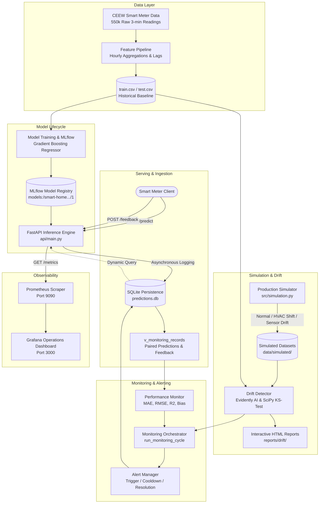

# AI-Assisted Smart Home Energy Advisor — End-to-End MLOps Integration

[](tests/)
[](https://www.python.org/)
[](https://fastapi.tiangolo.com/)
[](https://mlflow.org/)
[](https://evidentlyai.com/)
[](https://prometheus.io/)
[](https://grafana.com/)

An end-to-end Machine Learning Operations (MLOps) platform for residential electricity consumption forecasting. The system predicts next-hour household energy consumption from smart-meter telemetry and manages the operational model lifecycle: automated inference, delayed ground-truth feedback ingestion, production data simulation, statistical and Evidently AI drift detection, model performance evaluation against baselines, automated alerting with recovery, and Prometheus/Grafana observability.

---

## 1. Project Overview

Accurate hour-ahead electricity forecasting enables residential consumers to optimize high-load appliance scheduling (e.g. HVAC, water heating, EV charging) and assists grid utilities in localized demand management.

The predictive model is trained on the empirical **CEEW (Council on Energy, Environment and Water) Mathura Smart Meter Dataset** (2021), comprising 550,560 raw multi-minute readings across 35 residential households. Cleaned into strict hourly intervals, the model uses six historical and calendar features to forecast next-hour energy consumption (`target_next_hour` in kWh).

### Operational Highlights
- **Winning Model Architecture:** Gradient Boosting Regressor (`n_estimators=100`, `max_depth=5`, `learning_rate=0.1`, `random_state=42`) using six canonical telemetry and calendar features.
- **Phase 1 Historical Baseline Checkpoint:**
  - Trained on merged `train + validation` splits ($N=22,781$ rows).
  - Evaluated on all $N=4,120$ held-out chronological test rows (`data/test.csv`).
  - Empirical Baseline Metrics: $\text{MAE} = 0.0739\text{ kWh}$, $\text{RMSE} = 0.1512\text{ kWh}$, $R^2 = 0.3723$, and $\text{Mean Bias} = +0.001534\text{ kWh}$.
- **MLflow Registry Version 1 Checkpoint (`models:/smart-home-energy-advisor/1`):**
  - Identical model architecture and hyperparameters, logged during initial experiment comparison.
  - Trained on `train.csv` only ($N=18,696$ rows).
  - Full test set performance ($N=4,120$ rows): $\text{MAE} = 0.0738\text{ kWh}$, $\text{RMSE} = 0.1510\text{ kWh}$, $R^2 = 0.3736$, and $\text{Mean Bias} = +0.002273\text{ kWh}$.
  - *Note on Model Lineage:* These represent two distinct training checkpoints of the same architecture, not identical serialized artifacts. Both exhibit virtually identical generalization. The Phase 3.7 authentic demonstration draws a reproducible 35-row sample from `data/test.csv` (using seed 42) to evaluate operational accuracy against the Phase 1 baseline.
- **Real-Time Serving:** High-throughput FastAPI REST API with non-blocking SQLite prediction logging.
- **Closed-Loop Feedback:** Asynchronous actual-value feedback ingestion and automated record pairing.
- **Production Simulation:** Deterministic scenario generator simulating normal operation, afternoon HVAC load spikes (covariate shift), and sensor decay (calibration bias).
- **Drift & Degradation Detection:** SciPy Kolmogorov-Smirnov statistical tests, Cohen's $d$ effect sizes, Evidently AI interactive HTML reports, and baseline degradation alerts (with $\ge 30$ sample statistical threshold).
- **Automated Lifecycle Orchestration:** Self-healing alert state machine with duplicate cooldown and automatic recovery upon distribution normalization.
- **Enterprise Observability:** Prometheus `/metrics` exposition and pre-provisioned Grafana monitoring dashboards.

---

## 2. Architecture Diagram



---

## 3. Technology Stack

| Layer | Technologies | Purpose |
| :--- | :--- | :--- |
| **Core Framework** | Python 3.10–3.13, NumPy, Pandas, SciPy | Data processing, statistical hypothesis testing, and numerical computation. |
| **Machine Learning** | Scikit-learn, Joblib | Gradient Boosting, Random Forest, Linear Regression, and Persistence modeling. |
| **Experiment Tracking** | MLflow, Weights & Biases (W&B) | Hyperparameter logging, model signatures, metrics tracking, and Model Registry. |
| **Inference API** | FastAPI, Uvicorn, Pydantic v2 | High-performance asynchronous REST API with strict input/output validation. |
| **Persistence** | SQLite3, PRAGMA foreign keys, SQL Views | Decoupled prediction logging, feedback storage, alert state tracking, and run history. |
| **Drift Monitoring** | Evidently AI, SciPy (KS-test, Cohen's $d$) | Feature-level distribution shift, target concept drift, and interactive visual reports. |
| **Observability** | Prometheus (`prometheus_client`), Grafana | Real-time metric scraping, time-series storage, and operational dashboard visualization. |
| **Containerization** | Docker, Docker Compose | Multi-container microservice orchestration (`api`, `prometheus`, `grafana`). |
| **Testing & CI** | Pytest (271 tests), Starlette TestClient | Unit testing, statistical assertions, alert lifecycle validation, and end-to-end integration. |

---

## 4. Canonical Model Features

The model consumes six features to forecast the next hour's electricity consumption (`target_next_hour` in kWh):

| Feature Name | Type | Description | Valid Bounds |
| :--- | :---: | :--- | :--- |
| `energy_current_hour` | Float | Electricity consumption during the current hour ($t$) | $\ge 0.0$ kWh |
| `energy_previous_hour` | Float | Electricity consumption during the previous hour ($t-1$) | $\ge 0.0$ kWh |
| `energy_two_hours_ago` | Float | Electricity consumption two hours ago ($t-2$) | $\ge 0.0$ kWh |
| `target_hour` | Integer | Hour of the day for the prediction target | $0 - 23$ |
| `target_day_of_week` | Integer | Day of the week for the target | $0 = \text{Monday}, 6 = \text{Sunday}$ |
| `target_is_weekend` | Integer | Weekend binary indicator | $0 = \text{Weekday}, 1 = \text{Weekend}$ |

---

## 5. Quickstart: Reproducible End-to-End Demonstration

The platform includes a self-contained demonstration script (`scripts/run_end_to_end_demo.py`) that executes the complete 10-stage operational lifecycle.

### 5.1 One-Command Automated Run

Run the demonstration script using the local virtual environment:

```bash
.venv\Scripts\python.exe scripts/run_end_to_end_demo.py --samples 35
```

*(On Linux/macOS, use `python scripts/run_end_to_end_demo.py --samples 35`)*.

### 5.2 What the Demonstration Executes:
1. **Model Verification:** Loads `GradientBoostingRegressor` from MLflow Registry or local artifact.
2. **Service Connectivity:** Tests API `/health` endpoint.
3. **Prediction Generation:** Sends 35 inference requests to `/predict` and confirms SQLite persistence.
4. **Feedback Ingestion:** Ingests delayed actual energy feedback into `/feedback` and confirms pairing in `v_monitoring_records`.
5. **Production Simulation:** Generates and validates 200 hours of normal smart-meter observations.
6. **Drift Detection:** Compares simulated data against baseline `data/train.csv` using SciPy KS-tests and renders an Evidently AI HTML report.
7. **Performance Evaluation:** Computes MAE, RMSE, $R^2$, and Bias against empirical baselines.
8. **Automated Monitoring Cycle:** Orchestrates drift and performance evaluations, recording metadata in `monitoring_runs`.
9. **Observability Exposition:** Scrapes `/metrics` and validates Prometheus gauges and counters.
10. **Drift & Alert Lifecycle:** Simulates afternoon HVAC spikes ($66.7\%$ drift share $\to$ `[CRITICAL] data_drift` alert), sensor calibration offset, and automatic alert resolution upon return to normal data.

For full technical details, consult the [End-to-End Demonstration Guide](docs/end_to_end_demo_guide.md).

---

## 6. Running the API & Connecting Services

### 6.1 Running the Live FastAPI Service

To run the REST API server locally:

```bash
uvicorn api.main:app --host 127.0.0.1 --port 8000 --reload
```

- **Interactive Swagger Docs:** [http://127.0.0.1:8000/docs](http://127.0.0.1:8000/docs)
- **Service Health Check:** `GET http://127.0.0.1:8000/health`
- **Prometheus Scrape Endpoint:** `GET http://127.0.0.1:8000/metrics`

### 6.2 Running the Demo against a Live Server

```bash
python scripts/run_end_to_end_demo.py --api-url http://127.0.0.1:8000 --samples 35
```

---

## 7. Prometheus & Grafana Observability

When running on Docker-enabled infrastructure, full containerized observability is available:

```bash
# Start all microservices in the background
docker-compose up -d

# Verify container statuses
docker-compose ps
```

### Access URLs:
- **FastAPI Inference Service:** [http://localhost:8000](http://localhost:8000)
- **Prometheus UI:** [http://localhost:9090](http://localhost:9090)
  - Verify target `api:8000` is active under **Status -> Targets**.
  - Query metrics such as `energy_advisor_dataset_drift_share` or `energy_advisor_model_mae`.
- **Grafana Dashboard:** [http://localhost:3000](http://localhost:3000)
  - Auto-provisions the Prometheus datasource and the **Smart Home Energy Advisor - MLOps Operations** dashboard.
  - Features real-time visual panels for API traffic, inference latency percentiles, feature drift shares, model performance degradation, and active alert state counters.

For complete metrics definitions and PromQL queries, see the [Observability Guide](docs/observability_guide.md).

---

## 8. Automated Testing

The repository contains a test suite of **271 automated tests** covering data validation, feature engineering, model training, MLflow tracking, database persistence, drift detection, performance monitoring, alert lifecycle management, Prometheus exposition, and end-to-end integration.

Run the full test suite:

```bash
.venv\Scripts\python.exe -m pytest tests/ -v
```

### Test Suite Structure:
- `tests/test_data_validation.py`: Raw 3-minute schema, missing values, timestamp intervals, and CEEW daily aggregation parity.
- `tests/test_features.py`: Hourly aggregation, lag sequence continuity, calendar features, and target formulation.
- `tests/test_model.py`: Model benchmarks, chronological train/val/test evaluation, and scikit-learn interfaces.
- `tests/test_experiment_tracking.py`: MLflow run logging, metric calculation, artifact persistence, and Model Registry staging.
- `tests/test_api.py`: FastAPI `/health`, `/predict`, input schema validation, and background logging.
- `tests/test_monitoring.py`: SQLite persistence, schema constraints, record pairing, and feedback validation.
- `tests/test_simulation.py`: Normal, HVAC-shift, and sensor-drift synthetic data generation and statistical integrity.
- `tests/test_drift.py`: Two-sample KS-tests, Cohen's $d$, Evidently AI presets, and dataset drift thresholds.
- `tests/test_performance_monitor.py`: MAE/RMSE/$R^2$/Bias evaluation, time window filtering, and baseline degradation alerts.
- `tests/test_alert_manager.py`: Alert state machine, deduplication cooldown, manual/automatic resolution, and notification formatting.
- `tests/test_prometheus_metrics.py`: Custom collector, low-cardinality endpoint sanitization, registry safety, and YAML configurations.
- `tests/test_end_to_end_integration.py`: Complete operational lifecycle integration tests under isolated temporary databases.

---

## 9. Known Limitations & Environment Constraints

1. **Docker Host Availability:**
   - In environments where the Docker daemon is not active or unavailable (such as bare Windows hosts without WSL2/Hyper-V), the containerized stack (`docker-compose.yml`) cannot be started.
   - The entire Python application, API, database layer, simulation engine, drift detector, and end-to-end demonstration scripts are designed with **zero container dependencies** and execute natively in standard Python.
2. **Local Single-Node Persistence:**
   - The operational database is implemented in SQLite3 with write-ahead logging (WAL) and foreign keys enabled. For high-throughput distributed multi-region deployments, a migration to PostgreSQL with connection pooling would be required.
3. **Statistical Sample Requirement:**
   - Model performance degradation monitoring strictly enforces a minimum of 30 feedback records (`min_samples = 30`) before evaluating performance alerts. Running evaluations on fewer records returns `insufficient_data` to prevent statistical noise from triggering false alarms.
4. **Data Provenance:**
   - Historical baseline data originates from 50 households in Mathura, India (2021). Operational production data and demonstration feedback are synthetically generated and explicitly labeled as demonstration artifacts.